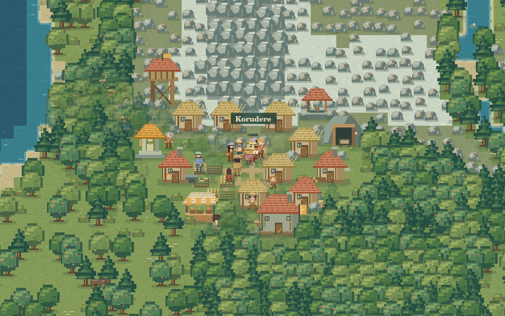

# Villages

**Küçük hayatlar, büyük hikâyeler.** Tarayıcıda yaşayan, tamamen piksel sanatıyla çizilmiş bir medeniyet simülasyonu.

İnsanlar yiyecek arar, yorulur, dinlenir, öğrenir, aile kurar ve yaşlanır. Birlikte ürettikleri fazlalık yerleşimlere dönüşebilir; kaynak baskısı göçe veya çatışmaya yol açabilir. Hikâyeyi belirleyen bir görev dizisi yoktur. Aynı çevrede çalışan bireysel kurallar birbirlerinin koşullarını değiştirir.



*Gerçek simülasyondan bir an: `Söğüt Vadisi`, 480. gün. Önizleme için binalar veya karakterler elle yerleştirilmedi.*

## Dünyada neler oluyor?

- **Birbirinden farklı insanlar:** İsimler, aile bağları, yedi kalıtsal eğilim, kişisel envanter, sağlık, açlık, enerji, sosyal ihtiyaç ve moral. Çocukların görünüşleri ve eğilimleri ebeveynlerinden izler taşır.
- **Gözle görülen bir ömür:** Bebek, çocuk, genç, yetişkin ve yaşlı için farklı beden oranları ve duruşlar. Yirmi seviyenin her birinde değişen kıyafet işlemesi; ilerleyen ustalıkla çanta, pelerin ve ekipman ayrıntıları.
- **On iki iş:** Toplayıcı, çiftçi, oduncu, madenci, balıkçı, avcı, inşaatçı, demirci, şifacı, tüccar, savaşçı ve bilgin. İşler ihtiyaç, malzeme, tecrübe ve çevredeki olanaklara göre ağırlık kazanır. Bir insan yaşamı boyunca farklı işlerde deneyim kazanabilir.
- **Gerçek kaynak akışı:** Kaynak araziden azalır, birinin envanterine girer ve yerleşime taşınır. Evler malzeme ve emek ister. Aletler üretimi artırır ve yıpranır; yiyecek tüketilir ve depoda bozulur. Tüccarlar yüklerini fiziksel olarak taşır.
- **Koşullardan doğan topluluklar:** Yakınlık, yetişkin nüfus, üretim deneyimi, verimli arazi ve ortak erzak bir obanın temelini oluşturur. Konut, iş bölümü, altyapı ve bilgi birikimi mezra, köy, kasaba ve kent evrelerini açar. Kapasite kaybolursa yerleşim gerileyebilir.
- **Aileler ve kuşaklar:** Yetişkin eşler, yeterli beslenme ve yaşam koşulları doğum olasılığını etkiler. Gebelik zaman alır. Bebeklerin bakımı, yaşayan aile üyeleri, kuşak numarası ve çocuklar kişi defterinden izlenebilir.
- **Göç, ticaret ve savaş:** Kıtlık, barınma sıkıntısı, çatışma ve bazı bireylerin merakı aileleri yola çıkarabilir. Yerleşimler ticaretle güven ve bilgi kazanır. Bölge baskısı, kıtlık ve gerginlik savaşa; yorgunluk ve kayıplar barışa yol açabilir.
- **Yaşayan çevre:** Tohumdan üretilen nehirler, geçitler, kıyılar, ormanlar, tepeler ve dağlar. Dört mevsim, yağmur, kar, kuraklık, yangın, sulama, büyüyen ekinler ve sınırlı kaynaklar. Geyik, yaban domuzu ve kurtların da beslenme, hareket ve üreme döngüleri vardır.
- **On üç yapı:** Ortak ocak, kulübe, ev, ambar, kuyu, oduncu alanı, maden, atölye, pazar, kışla, gözetleme kulesi, yönetim evi ve tapınak. İnşaat sırasında arazi gerçekten temizlenir; yangınlar yapıları kullanılmaz hale getirebilir.

Mekaniklerin ayrıntıları ve medeniyet eşikleri [Simülasyon kuralları](docs/SIMULATION.md) belgesinde açıklanıyor.

## Gözlemci masası

Haritada bir kişiye, yapıya veya yere tıklayarak ayrıntılarını aç. Bir insanı takip edip ihtiyaçlarını, işini, ustalığını, eşyalarını ve ailesini izle. Yerleşim defteri stokları, bilgi birikimini, ilişkileri ve sakinleri gösterir. Dünya kroniğindeki olaylar ve nüfus grafiği gerçek simülasyon durumundan üretilir.

Doğal görünümün yanında **medeniyet sınırları, toprak verimliliği, doğal kaynaklar ve tehlike** katmanları bulunur. Atlas ve kamera kontrolleri büyük haritalarda gezinmeyi kolaylaştırır. Mobilde ayrıntı defteri açılır bir paneldir; harita sürükleme ve iki parmakla yakınlaştırmayı destekler.

Dünyaya müdahale etmek istersen yağmur, yiyecek, ağaç, yeni insanlar ve ateş araçlarını kullanabilirsin. Müdahaleler aynı araziyi ve aynı kaynakları değiştirir; sonuçlar yine simülasyon kurallarından doğar. Ortam sesi istek üzerine açılır; rüzgâr ve kuş sesleri tarayıcıda sentezlenir.

### Zaman ve kontroller

Bir yıl **96**, bir mevsim **24 simülasyon günü** sürer. `1×` hız hedefi gerçek bir saniyede bir simülasyon günüdür. `2×`, `5×`, `10×` ve `25×` seçenekleri nesillerin değişimini izlemeyi kolaylaştırır. Düşük performanslı cihazlarda gerçek ilerleme hızı hedefin altında kalabilir; arka plandaki sekmede zaman ilerlemez.

| Kontrol | İşlev |
|---|---|
| Tıkla / dokun | İnsan, yapı, yerleşim veya araziyi incele |
| Sürükle | Haritada gezin |
| Fare tekerleği / iki parmak | Yakınlaştır ve uzaklaştır |
| `Boşluk` | Duraklat / sürdür |
| `1` – `5` | Sırasıyla 1×, 2×, 5×, 10×, 25× |
| `.` | Duraklatıp 0,1 simülasyon günü ilerlet |
| `+` / `−` | Yakınlaştır / uzaklaştır |
| `F` | Seçili kişiyi takip et |
| `C` | Bütün dünyayı göster |
| `Esc` | Seçimi temizle ve gözlem aracına dön |
| `H` / `?` | Gözlemci rehberini aç |

Form alanları ve açık diyaloglarda oyun kısayolları yazmayı engellemez.

### Kayıt ve yeni dünyalar

**Elle kayıt ve otomatik kayıt ayrı yuvalardır.** Otomatik kayıt, dünya çalışırken yaklaşık 30 saniyede bir ve sekmeden ayrılırken alınır. Normal sayfa yenilemesi son otomatik kaydı duraklatılmış halde geri getirir. Yeni bir dünya, elle sakladığın dünyayı silmez; menüden her iki kayıt ayrı ayrı açılabilir.

JSON dışa aktarma/içe aktarma bütün dünya durumunu, aileleri, süren işleri, ticaret yolculuklarını ve rastgele sayı üretecinin durumunu taşır. Dosya yüklenmeden önce doğrulanır. Tarayıcı depolaması kapalı veya doluysa dosya olarak dışa aktarabilirsin. Tarayıcı verilerinin silinmesi yerel kayıtları da siler; JSON dosyası taşınabilir yedektir.

Yeni dünya penceresinde tohum, başlangıç nüfusu, harita büyüklüğü, iklim ve çatışma eğilimi seçilir. Başlangıç nüfusu 24–192, yaşayan insan üst sınırı 500'dür. URL'ye `?seed=Ardıç` eklemek o tohumla yeni bir dünya açar; yalnız tohum bağlantısı bir kayıt dosyasının yerine geçmez. Aynı motor sürümü, ayarlar ve aynı adımlarda uygulanan müdahaleler aynı sonucu üretir.

## Yerelde çalıştırma

Geliştirme araçları için **Node.js 24 veya üstü** yeterlidir. Projede kurulum gerektiren npm bağımlılığı yoktur.

```bash
npm run dev
```

Uygulamayı `http://localhost:4173` adresinde aç. ES modülleri nedeniyle `index.html` dosyasını doğrudan `file://` ile açmak yerine bir HTTP sunucusu kullan.

```bash
npm run check
npm test
npm run build
```

`build`, kendi başına sunulabilen statik dosyaları `dist/` içine kopyalar ve yerel dosya yollarını doğrular. Çalışma zamanında sunucu API'si, hesap, gizli anahtar, CDN veya harici font gerektirmez. Bütün çalışma zamanı yolları görecelidir; depo alt yolu altında çalışabilir. Depo kökündeki uygulama da derleme gerektirmeden statik sunulabilir.

## Piksel sanatı

Bütün oyun sprite'ları bu repo için Canvas üzerinde piksel piksel çizilir. Üçüncü taraf sprite paketi veya emoji karakter kullanılmaz. Ortak çizici; oyun, karakter portreleri ve görsel katalog tarafından paylaşılır.

Karakter sistemi 8 ten tonu, 10 saç tonu, 10 saç biçimi, 12 giysi paleti, 8 vurgu rengi ve 16 beden/giyim varyantını birleştirir. Bunlara yaşam evresi, cinsiyet, meslek, yön, hareket ve seviye ayrıntıları eklenir. Animasyonlar gerçek eylemlerle bağlantılıdır; hedefe yürüyen bir kişi varıştan önce odun kesme veya kazma efekti çıkarmaz.

Çalışan geliştirme sunucusunda `/docs/assets-preview.html` sayfası yaşları, görünüş varyantlarını, meslek hareketlerini, 20 seviyeyi ve yapıların inşa evrelerini gösterir. Aynı katalog statik çıktıya da dahildir.

## Doğrulama ve geliştirme

Node'un yerleşik test çalıştırıcısıyla; deterministik arazi üretimi, gerçek nehir geçişleri, ulaşılmaz bölgeler, genetik çeşitlilik, soy yaşları, mevsim sınırları, ölüm nedenleri, savaş hasarı, nüfus sınırı, müdahale etkileri ve bozuk kayıtlar sınanır. Otomatik testlerin uzun koşusu **3.000 simülasyon günü** boyunca dünyayı kontrol eder; bu olgun dünya kaydedilip yüklendikten sonra kararların ve olayların birebir aynı devam ettiğini karşılaştırır.

GitHub Actions, değişikliklerde sözdizimi/import denetimini, testleri ve statik üretimi çalıştırır. Tarayıcı arayüzü ayrıca masaüstü ve dar ekran üzerinde elle doğrulanmıştır. Mimari, API'ler ve yeni sistem ekleme noktaları [Teknik sözleşme](docs/CONTRACT.md) içinde bulunur.

### Tasarım sınırları

Bu bir kurallı oyuncak dünya modelidir. İnsan davranışını veya tarihsel medeniyetleri bilimsel olarak tahmin etmez. Karakterler LLM kullanmaz; ihtiyaç öncelikleri, ağırlıklı olasılıklar, yerel ilişkiler ve yol bulma ile hareket eder. Belirli bir tohumun mutlaka kent, savaş veya sınırsız nüfus üretmesi garanti edilmez; topluluklar sönümlenebilir.

Oyun tek sekmede ve cihazda çalışır; çok oyunculu sunucu veya bulut kayıt eşitlemesi yoktur. Deniz taşımacılığı bulunmaz; hareket kara bölgeleri ve fiziksel geçitlerle sınırlıdır. Son olaylar, grafik örnekleri ve mezar kayıtları uzun süreli çalışmada belleği sınırlamak için tutulabilecek sayı ile sınırlandırılmıştır. 500 insan üst sınırı, büyük harita ve yüksek hız birlikte kullanıldığında cihazın kapasitesi belirleyicidir.
